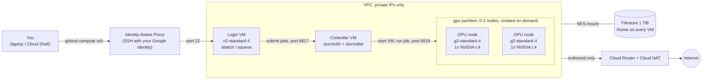

# GCP GPU Slurm Cluster with Cluster Toolkit

A minimal [Google Cluster Toolkit](https://github.com/GoogleCloudPlatform/cluster-toolkit) blueprint that deploys an autoscaling GPU Slurm cluster on Google Cloud, using NVIDIA L4 GPUs.

## Architecture



1. You SSH to the **login VM** through **IAP**. No VM has a public IP.
2. `sbatch --gpus=1 job.sh` sends the job to the **controller**.
3. The controller **creates a GPU VM** if none is free, runs the job on it, and **deletes the VM** after 5 idle minutes.
4. Every VM mounts the shared **`/home`** from Filestore, so code and results are visible everywhere.
5. VMs reach the internet **outbound only**, through Cloud NAT.

## What it builds

| Module | Purpose |
|---|---|
| `network` | VPC for the cluster |
| `homefs` | 1 TiB `BASIC_HDD` Filestore share mounted as `/home` on every node |
| `gpu_nodeset` | Up to 2 `g2-standard-4` VMs (4 vCPUs, 16 GB RAM, 1 NVIDIA L4 GPU each), created on demand and deleted when idle |
| `gpu_partition` | The `gpu` Slurm partition, the only and default queue (`exclusive: false`, so nodes linger briefly between jobs) |
| `slurm_login` | Login node where users SSH in and run `sbatch` / `srun` (private IP only) |
| `slurm_controller` | Slurm controller that ties everything together (private IP only) |

Every VM uses the same image, `aci-gpu-u2404-slurm-2605-cuda-132-nvidia-595-amd64`: Ubuntu 24.04, Slurm 26.05, NVIDIA driver 595 and CUDA 13.2. This matches how Google's own GPU blueprints set the image for the whole cluster.

The VPC module also creates firewall rules for internal traffic and IAP SSH, plus a Cloud Router and Cloud NAT so private VMs can reach the internet outbound.

## How it works

You don't write Terraform by hand. The `gcluster` CLI reads the YAML blueprint, resolves the `use:` links between modules, generates a full Terraform project, and runs it.

```
blueprint (YAML)  →  gcluster  →  Terraform (+ Packer)  →  cluster on GCP
```

## Prerequisites

- A Google Cloud project with billing enabled
- `gcloud` authenticated (`gcloud auth application-default login`)
- [Terraform](https://developer.hashicorp.com/terraform/install) installed
- The `gcluster` binary, from the [Cluster Toolkit releases](https://github.com/GoogleCloudPlatform/cluster-toolkit/releases) or built from source with `make`

### Permissions and APIs (one-time)

Run `setup-permissions.sh` as a project Owner or Project IAM Admin. It enables the required APIs, grants the deployer the roles to create the cluster and SSH in through IAP, and grants the default Compute Engine service account the roles the Slurm controller needs to create compute VMs.

```bash
./setup-permissions.sh <YOUR_PROJECT_ID> <DEPLOYER_EMAIL>
# Already a project Owner? Skip the deploy roles:
SKIP_USER_ROLES=1 ./setup-permissions.sh <YOUR_PROJECT_ID> <DEPLOYER_EMAIL>
```

### Quota (request before deploying)

In `us-central1`, 2 `g2-standard-4` nodes need **2 NVIDIA L4 GPUs** (`NVIDIA_L4_GPUS`) and **8 G2 vCPUs**. GPU quota often starts at 0, so request it first. Without it, the cluster deploys but GPU nodes fail to start and jobs stay pending.

## Usage

```bash
# 1. Generate the Terraform deployment folder
./gcluster create hpc-slurm.yaml --vars project_id=<YOUR_PROJECT_ID>

# 2. Deploy (runs terraform init/plan/apply)
./gcluster deploy hpc-slurm

# 3. SSH to the login node through IAP (it has no public IP)
gcloud compute instances list --filter="name~login"   # find the login VM name
gcloud compute ssh <LOGIN_VM_NAME> --zone us-central1-a --tunnel-through-iap

# 4. Wait until `sinfo` shows the gpu partition, then submit a test job
srun --gpus=1 nvidia-smi             # should list one NVIDIA L4

# 5. Tear everything down when finished
./gcluster destroy hpc-slurm
```

Jobs go to the `gpu` queue by default, but **must request the GPU** with `--gpus=1`. Without it, a job only gets the node's CPUs and can't see the GPU.

```bash
#!/bin/bash
#SBATCH --gpus=1
#SBATCH --time=01:00:00
python train.py
```

## Example: train here, serve on Vertex AI

[`examples/train-to-vertex/`](examples/train-to-vertex/) fine-tunes a Hugging Face model on the L4 with `sbatch` (training data from the Hugging Face Hub or a BigQuery query), uploads it to Cloud Storage, registers versions in the Vertex AI Model Registry, serves it from a Vertex AI endpoint through a small custom container, and monitors live traffic for drift (BigQuery request-response logs, Cloud Monitoring alerts).

## Example: the same model on AWS SageMaker, with drift monitoring

[`examples/sagemaker-hf/`](examples/sagemaker-hf/) trains and serves the same DistilBERT sentiment model on SageMaker (SDK v3, NVIDIA L4 `ml.g6.xlarge`), captures endpoint traffic, and scores it for drift against a baseline built during training, using PSI plus a significance test so small samples don't raise false alarms. It publishes CloudWatch metrics and an SNS alarm, without SageMaker Model Monitor.

## Using plain Terraform instead

Run `gcluster create` once, then manage the generated `hpc-slurm/` folder with normal `terraform plan` / `terraform apply`, a remote state backend and your usual CI.

## Customizing

- **More GPU jobs at once:** raise `node_count_dynamic_max` (and your L4 quota).
- **Bigger GPUs:** change `machine_type` in `gpu_nodeset` to `g2-standard-48` (4 L4s), an `a2` (A100) or an `a3` (H100) type, and check quota and zone availability. Jobs can share a multi-GPU node, each getting its own GPUs, e.g. `sbatch --gpus=2 train.sh`.
- **Region/zone:** edit the `vars` block; the zone must offer your GPU type.
- **Faster storage:** set `filestore_tier: BASIC_SSD` and `size_gb: 2560` (the SSD tier's minimum).
- **CPU-only work:** add a CPU nodeset and partition (see `examples/hpc-slurm.yaml` in the toolkit) rather than running large CPU jobs on the 4-vCPU GPU nodes.

## Notes

- Module paths and settings change between toolkit releases. Compare against the `examples/` folder of the version you install.
- The login and controller nodes have no public IPs. SSH access uses IAP, which needs the `IAP-secured Tunnel User` role on your account.
- The controller, login and GPU nodes get 100 GB boot disks, because the GPU image is larger than the modules' 50 GB default.
- This blueprint has been checked against current module inputs but not test-deployed.
- Running this creates billable resources. Remember to `destroy` when done.
