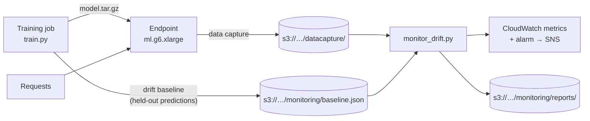

# Hugging Face on SageMaker: train, deploy, predict, monitor drift

The AWS counterpart of [`../train-to-vertex`](../train-to-vertex): fine-tune DistilBERT to classify movie reviews as **POSITIVE** or **NEGATIVE** on a SageMaker GPU, serve it from an endpoint, and **watch live traffic for drift**. Written for the **SageMaker Python SDK v3** (`ModelTrainer`, `ModelBuilder`). Both training and serving use `ml.g6.xlarge`: 4 vCPUs, 16 GB RAM and **1 NVIDIA L4**, the same GPU as the Slurm cluster.



## Files

| File | What it does |
|---|---|
| `run_sagemaker.py` | Runs on your laptop or SageMaker Studio: trains, deploys **with data capture**, predicts, cleans up |
| `train/train.py` | Runs **inside** the training job: fine-tunes, saves the model, builds and uploads the **drift baseline** |
| `train/drift.py` | Shared drift code: text features, PSI scoring (plain Python, also used by the monitor) |
| `monitor_drift.py` | Scores recent endpoint traffic against the baseline; can publish CloudWatch metrics, save reports and create an alarm |
| `tests/test_drift.py` | Tests, including a real tiny training run on CPU |

## Run

**Prerequisites:** AWS credentials, a SageMaker execution role (e.g. `AmazonSageMakerFullAccess`, which covers the default `sagemaker-<region>-<account>` bucket), and quota for `ml.g6.xlarge` for **training job usage** and **endpoint usage**. New accounts often start at 0.

```bash
pip install "sagemaker>=3"
python run_sagemaker.py --role arn:aws:iam::<ACCOUNT_ID>:role/<SageMakerRole> --region us-east-1 --keep-endpoint
```

1. **Train:** starts a GPU training job, fine-tunes on 2,000 reviews, and uploads the model plus `hf-sentiment/monitoring/baseline.json` to the default bucket.
2. **Deploy:** creates an endpoint that **captures every request and response** to `hf-sentiment/datacapture/`.
3. **Predict:** sends two reviews and prints the labels.
4. **Clean up:** deletes the endpoint, unless you pass `--keep-endpoint`, which drift monitoring needs. **A kept endpoint bills every hour until you delete it.**

Options: `--skip-deploy`, `--epochs`, `--train-samples`, `--capture-percent`, `--bucket`, `--prefix`, `--train-instance-type`, `--deploy-instance-type`.

## Drift monitoring

**Why not SageMaker Model Monitor?** AWS has [closed Model Monitor (and Clarify) to new customers](https://docs.aws.amazon.com/sagemaker/latest/dg/model-monitor-availability-change.html) and recommends custom monitoring with data capture, CloudWatch and open-source tools. That's what this does.

**The baseline** is built at the end of training from the held-out reviews **and the model's own predictions**, so it describes both normal inputs and normal outputs:

| Feature | Catches |
|---|---|
| `input_words`, `input_chars` | Much longer or shorter text than in training |
| `input_non_ascii_ratio`, `input_digit_ratio` | A new language, order numbers, codes |
| `input_exclamations`, `input_is_question` | A different style of text (questions, complaints) |
| `pred_positive` | The share of POSITIVE predictions shifting |
| `confidence` | The model becoming unsure, often the earliest sign it no longer fits the data |

**Scoring:** each feature is binned like the baseline and compared with the **Population Stability Index (PSI)**: below 0.1 no meaningful change, 0.1–0.2 moderate, 0.2 or more significant. Values outside the range seen in training get their own bins, so they always register.

PSI alone is noisy on small samples. In simulations of unchanged traffic, a fixed PSI threshold raised false alarms most of the time with small baselines. So a feature only counts when its shift is also **statistically significant** (a chi-square test on the binned counts, at 1% overall, Bonferroni-corrected across features). The **drift score** is the highest PSI among significant features, and 0 when none are. With this, the same simulations gave about 1% false alarms or less from 30 samples upward, while clear shifts were still caught every time.

**Check drift** (after some traffic has reached the endpoint):

```bash
python monitor_drift.py --endpoint hf-sentiment-<stamp> --region us-east-1
```
```text
Endpoint hf-sentiment-<stamp>: significant (412 samples, last 24h)
feature                      PSI   p-value  baseline mean  live mean
confidence                 1.842   4.1e-61          0.931      0.611  <-- drift
pred_positive              0.733   2.9e-29          0.502      0.087  <-- drift
input_non_ascii_ratio      0.412   7.7e-15          0.001      0.024  <-- drift
...
```
(The output above is illustrative.)

- `--publish-metrics`: CloudWatch namespace `HFSentiment/ModelDrift`, with `DriftScore` and `SampleCount` per endpoint plus `PSI` per feature
- `--save-report`: JSON report to `s3://<bucket>/hf-sentiment/monitoring/reports/<endpoint>/YYYY/MM/DD/HH.json`
- `--create-alarm --sns-topic-arn <arn>`: alarm on `DriftScore ≥ --threshold` (default 0.2) that notifies the topic
- `--hours`, `--min-samples`: analysis window (default 24h) and minimum predictions before scoring (default 30)
- **Exit code 2** on significant drift, for cron jobs and CI

**Run it on a schedule:** it only needs `boto3`, so an hourly cron job or an EventBridge-scheduled Lambda both work. [ModelTrainingSagemaker](https://github.com/sumitgupta477/ModelTrainingSagemaker) shows the fully event-driven version in Terraform: a baseline Lambda on training completion, an hourly drift-check Lambda, and CloudWatch alarms to SNS.

## Tests

```bash
pip install pytest boto3 torch transformers datasets accelerate
pytest examples/sagemaker-hf/tests
```
Covers feature extraction, both data-capture encodings (JSON and base64), single and batched requests, the scoring rules (values outside the training range, chi-square accuracy, and a false-alarm and detection check over many random samples), the monitor end to end against in-memory S3 and CloudWatch fakes, and a **real tiny training run** that checks `train.py` writes a correct baseline.

## Notes

- Written for SageMaker Python SDK **v3** (checked against 3.28): `ModelTrainer` and `ModelBuilder` replace v2's `HuggingFace` estimator and model classes. The SDK creates AWS clients **when it's imported**, so `run_sagemaker.py` sets the region first.
- Container versions (transformers 4.56.2 for training, 4.51.3 for inference) come from the SDK's built-in list. Change them at the top of `run_sagemaker.py`.
- Captured traffic and reports accumulate in S3. Add a lifecycle rule (e.g. 30 days) to expire them.
- **Not yet run against an AWS account.** The drift code, the monitor and the training baseline are tested locally as described above.
