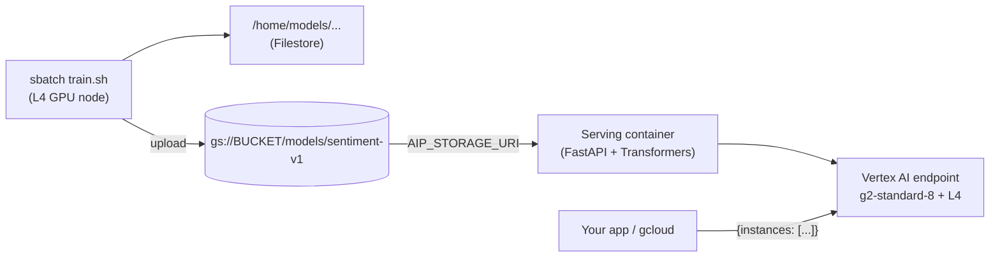

# Train on Slurm, serve on Vertex AI

Fine-tune a Hugging Face model (DistilBERT, positive / negative movie reviews) on the cluster's **NVIDIA L4** with `sbatch`, save it to **Cloud Storage**, and serve it from a **Vertex AI endpoint**.



## Files

| File | Runs on | What it does |
|---|---|---|
| `setup_vertex.sh` | Laptop / Cloud Shell, once | Enables APIs, creates the bucket and image repo, grants permissions |
| `setup_env.sh` | Login VM, once | Creates the Python training environment in `~/venv-train` (shared via `/home`) |
| `train.sh` | Slurm job (`sbatch`) | Requests 1 GPU and runs `train.py` |
| `train.py` | GPU node | Fine-tunes the model (data from the Hugging Face Hub or **BigQuery**), saves it to `/home`, uploads it to GCS |
| `query_example.sql` | — | Example BigQuery training query (`--bq_query_file`) |
| `serving/` | Vertex AI | Dockerfile + FastAPI server that loads the model from `AIP_STORAGE_URI` |
| `deploy_vertex.sh` | Laptop / Cloud Shell | Builds the image, registers the model, deploys an endpoint, tests it |
| `cleanup_vertex.sh` | Laptop / Cloud Shell | Undeploys and deletes the endpoint and model (stops billing) |

## Steps

**0. Prerequisites:** the cluster is deployed (see the main README) and `../../setup-permissions.sh` has been run.

**1. One-time Vertex AI setup** (laptop or Cloud Shell, as a project Owner):
```bash
./setup_vertex.sh <PROJECT_ID> <BUCKET_NAME> <your-email>
```
This also gives the cluster VMs **write access to that one bucket**, which the base setup doesn't include (it only grants read access).

**2. One-time training environment** (on the login VM):
```bash
git clone https://github.com/sumitgupta477/gcp-slurm-cluster-toolkit.git
cd gcp-slurm-cluster-toolkit/examples/train-to-vertex
bash setup_env.sh
```

**3. Train** (on the login VM, from this folder):
```bash
sbatch --export=ALL,GCS_MODEL_URI=gs://<BUCKET_NAME>/models/sentiment-v1 train.sh
squeue --me                            # PD -> CF (GPU node starting) -> R
tail -f train-to-vertex-<JOBID>.out    # watch training
```
The defaults (2,000 reviews, 1 epoch) take a few minutes on an L4. Pass extra options to `train.py` after the script name, e.g. `train.sh --epochs 2 --train_samples 10000`.

### Training on your own data from BigQuery

Point training at a BigQuery query instead of the IMDB dataset. The query must return:
- **`text`**: the input text
- **`label`**: `0`/`1`, or `negative`/`positive` (any capitalization)
- **`split`** *(optional)*: `train` or `test`. Without it, 20% is held out automatically (`--test_size`).

**a. Let the cluster read your dataset** (once; re-run `setup_vertex.sh` with `BQ_DATASET`):
```bash
BQ_DATASET=my-project.reviews ./setup_vertex.sh <PROJECT_ID> <BUCKET_NAME> <your-email>
```
This gives the cluster VMs **read access to that one dataset**, plus permission to run queries and use the fast BigQuery Storage API. Queries are billed to `<PROJECT_ID>`.

**b. Write the query in a file** (easier than quoting SQL backticks in the shell). Start from `query_example.sql`:
```sql
SELECT
  review_text AS text,
  sentiment   AS label,
  IF(MOD(ABS(FARM_FINGERPRINT(review_id)), 5) = 0, 'test', 'train') AS split
FROM `my-project.reviews.movie_reviews`
```

**c. Train:**
```bash
sbatch --export=ALL,GCS_MODEL_URI=gs://<BUCKET_NAME>/models/sentiment-bq train.sh \
  --bq_query_file my_query.sql --train_samples 20000 --eval_samples 2000
```
For a one-off, `--bq_query '...'` also works. Use **single quotes** so the shell doesn't treat the backticks as commands.

**Tips**
- BigQuery bills by **data scanned**: select only the columns you need, and filter or `TABLESAMPLE` while experimenting.
- The whole result is loaded into memory, which is fine up to a few GB. For bigger tables, `EXPORT DATA` to Parquet in GCS and train from the files instead.
- `--train_samples` and `--eval_samples` still cap how many rows are used (defaults 2000 and 500), so raise them for real training.

**4. Deploy to Vertex AI** (laptop or Cloud Shell):
```bash
./deploy_vertex.sh <PROJECT_ID> gs://<BUCKET_NAME>/models/sentiment-v1
```
It ends with a test prediction like:
```json
{"predictions": [{"label": "POSITIVE", "score": 0.98}, {"label": "NEGATIVE", "score": 0.97}]}
```

**5. Stop billing:**
```bash
./cleanup_vertex.sh
```

## How the serving container works

Vertex AI starts the container with these environment variables, and `server.py` uses them:

| Variable | Meaning |
|---|---|
| `AIP_STORAGE_URI` | GCS folder with the model (from `--artifact-uri`); downloaded at startup |
| `AIP_HTTP_PORT` | Port to listen on (8080) |
| `AIP_HEALTH_ROUTE` | `/health`: returns 503 while loading, 200 when ready |
| `AIP_PREDICT_ROUTE` | `/predict`: takes `{"instances": [...]}`, returns `{"predictions": [...]}` |

Test it locally without Vertex AI (needs `pip install -r serving/requirements.txt`):
```bash
cd serving && AIP_STORAGE_URI=~/models/<your-model-folder> uvicorn server:app --port 8080
curl -X POST localhost:8080/predict -H 'Content-Type: application/json' -d '{"instances": ["great film"]}'
```

## Costs

- **Training:** only while the job runs; the GPU node shuts down 5 minutes after it finishes.
- **Endpoint:** one `g2-standard-8` + L4 runs **24/7 until you run `cleanup_vertex.sh`**, even with no traffic. This is the main cost to watch.
- **Storage:** a few hundred MB per model in GCS, plus the serving image (a few GB) in Artifact Registry.

## Notes

- Training and serving pin the same versions (`torch 2.5.1`, `transformers 4.46.3`), so the saved model loads identically.
- Vertex AI also needs **L4 quota for prediction** in the region. It's separate from the Compute Engine quota the Slurm cluster uses, so check **IAM & Admin → Quotas**.
- In the same project, Vertex AI's service agent can normally read the bucket and pull the image. If deployment fails on permissions, check the deployment logs in **Vertex AI → Endpoints**.
- Tested locally on CPU (training on a toy model and dataset, including from a simulated BigQuery result; the server with Vertex AI's environment variables; GCS upload/download against a fake bucket), but **not yet run on the cluster, BigQuery or Vertex AI**.
