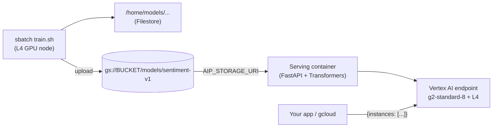
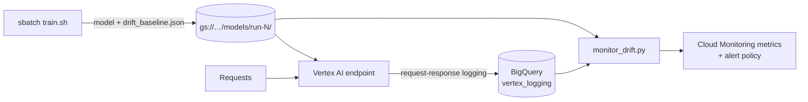

# Train on Slurm, serve on Vertex AI

Fine-tune a Hugging Face model (DistilBERT, positive / negative movie reviews) on the cluster's **NVIDIA L4** with `sbatch`, save it to **Cloud Storage**, and serve it from a **Vertex AI endpoint**.



## Files

| File | Runs on | What it does |
|---|---|---|
| `setup_vertex.sh` | Laptop / Cloud Shell, once | Enables APIs, creates the bucket and image repo, grants permissions |
| `setup_env.sh` | Login VM, once | Creates the Python training environment in `~/venv-train` (shared via `/home`) |
| `train.sh` | Slurm job (`sbatch`) | Requests 1 GPU and runs `train.py` |
| `train.py` | GPU node | Fine-tunes the model (data from the Hugging Face Hub or **BigQuery**), saves it to `/home`, uploads it to GCS |
| `query_example.sql` | — | Example BigQuery training query (`--bq_query_file`) |
| `serving/` | Vertex AI | Dockerfile + FastAPI server that loads the model from `AIP_STORAGE_URI` |
| `build_image.sh` | Laptop / Cloud Shell | Builds and pushes the serving image (needed once for `--register`) |
| `deploy_vertex.sh` | Laptop / Cloud Shell | Deploys a **registered model version**, or registers + deploys straight from GCS, then tests it |
| `drift.py` | — | Shared drift code: text features and scoring (plain Python), used by training and the monitor |
| `monitor_drift.py` | Laptop / Cloud Shell / cluster | Scores the endpoint's logged traffic against the deployed model's baseline |
| `cleanup_vertex.sh` | Laptop / Cloud Shell | Undeploys and deletes the endpoint and model (stops billing) |

## Steps

**0. Prerequisites:** the cluster is deployed (see the main README) and `../../setup-permissions.sh` has been run.

**1. One-time Vertex AI setup** (laptop or Cloud Shell, as a project Owner):
```bash
./setup_vertex.sh <PROJECT_ID> <BUCKET_NAME> <your-email>
```
This also gives the cluster VMs **write access to that one bucket**, which the base setup doesn't include (it only grants read access).

**2. One-time training environment** (on the login VM):
```bash
git clone https://github.com/sumitgupta477/gcp-slurm-cluster-toolkit.git
cd gcp-slurm-cluster-toolkit/examples/train-to-vertex
bash setup_env.sh
```

**3. Train** (on the login VM, from this folder):
```bash
sbatch --export=ALL,GCS_MODEL_URI=gs://<BUCKET_NAME>/models/sentiment-v1 train.sh
squeue --me                            # PD -> CF (GPU node starting) -> R
tail -f train-to-vertex-<JOBID>.out    # watch training
```
The defaults (2,000 reviews, 1 epoch) take a few minutes on an L4. Pass extra options to `train.py` after the script name, e.g. `train.sh --epochs 2 --train_samples 10000`.

### Training on your own data from BigQuery

Point training at a BigQuery query instead of the IMDB dataset. The query must return:
- **`text`**: the input text
- **`label`**: `0`/`1`, or `negative`/`positive` (any capitalization)
- **`split`** *(optional)*: `train` or `test`. Without it, 20% is held out automatically (`--test_size`).

**a. Let the cluster read your dataset** (once; re-run `setup_vertex.sh` with `BQ_DATASET`):
```bash
BQ_DATASET=my-project.reviews ./setup_vertex.sh <PROJECT_ID> <BUCKET_NAME> <your-email>
```
This gives the cluster VMs **read access to that one dataset**, plus permission to run queries and use the fast BigQuery Storage API. Queries are billed to `<PROJECT_ID>`.

**b. Write the query in a file** (easier than quoting SQL backticks in the shell). Start from `query_example.sql`:
```sql
SELECT
  review_text AS text,
  sentiment   AS label,
  IF(MOD(ABS(FARM_FINGERPRINT(review_id)), 5) = 0, 'test', 'train') AS split
FROM `my-project.reviews.movie_reviews`
```

**c. Train:**
```bash
sbatch --export=ALL,GCS_MODEL_URI=gs://<BUCKET_NAME>/models/sentiment-bq train.sh \
  --bq_query_file my_query.sql --train_samples 20000 --eval_samples 2000
```
For a one-off, `--bq_query '...'` also works. Use **single quotes** so the shell doesn't treat the backticks as commands.

**Tips**
- BigQuery bills by **data scanned**: select only the columns you need, and filter or `TABLESAMPLE` while experimenting.
- The whole result is loaded into memory, which is fine up to a few GB. For bigger tables, `EXPORT DATA` to Parquet in GCS and train from the files instead.
- `--train_samples` and `--eval_samples` still cap how many rows are used (defaults 2000 and 500), so raise them for real training.

### Registering automatically after training (model versions)

Add `--register` and each successful training run adds a **new version** of one model in the **Vertex AI Model Registry**: version 1 on the first run, then 2, 3, and so on. The newest version becomes the default. Registering **doesn't deploy** anything, so it costs nothing extra.

**a. Build the serving image once** (laptop or Cloud Shell). It prints the image URI:
```bash
./build_image.sh <PROJECT_ID>
# -> us-central1-docker.pkg.dev/<PROJECT_ID>/serving/hf-sentiment-server:latest
```

**b. Train with `--register`** (on the cluster). Give each run its own GCS folder, since versions point at their files:
```bash
sbatch --export=ALL,GCS_MODEL_URI=gs://<BUCKET_NAME>/models/run-$(date +%Y%m%d-%H%M),SERVING_IMAGE=us-central1-docker.pkg.dev/<PROJECT_ID>/serving/hf-sentiment-server:latest \
  train.sh --register --min_accuracy 0.85
```
- `--min_accuracy 0.85` registers **only if** evaluation accuracy is at least 85%. Leave it out to always register.
- `--model_display_name` chooses which registry model to add versions to (default `sentiment-classifier`).
- Each version records the Slurm job ID and accuracy (labels and description), and the job writes `registry.json` next to the saved model.

**c. See the versions:**
```bash
gcloud ai models list --region us-central1 --filter="displayName=sentiment-classifier"
gcloud ai models list-version <MODEL_ID> --region us-central1
```

**4. Deploy to Vertex AI** (laptop or Cloud Shell):
```bash
# A registered version (from --register): the default/newest, or pick one
./deploy_vertex.sh <PROJECT_ID> --model sentiment-classifier
./deploy_vertex.sh <PROJECT_ID> --model sentiment-classifier 3

# Or without --register: build, register and deploy straight from a GCS folder
./deploy_vertex.sh <PROJECT_ID> gs://<BUCKET_NAME>/models/sentiment-v1
```
It ends with a test prediction like:
```json
{"predictions": [{"label": "POSITIVE", "score": 0.98}, {"label": "NEGATIVE", "score": 0.97}]}
```

**5. Stop billing:**
```bash
./cleanup_vertex.sh
```
This deletes the endpoint. A registered model deployed with `--model` is **kept** with all its versions. Only the one-off model created by deploying straight from GCS is removed.

## How the serving container works

Vertex AI starts the container with these environment variables, and `server.py` uses them:

| Variable | Meaning |
|---|---|
| `AIP_STORAGE_URI` | GCS folder with the model (from `--artifact-uri`); downloaded at startup |
| `AIP_HTTP_PORT` | Port to listen on (8080) |
| `AIP_HEALTH_ROUTE` | `/health`: returns 503 while loading, 200 when ready |
| `AIP_PREDICT_ROUTE` | `/predict`: takes `{"instances": [...]}`, returns `{"predictions": [...]}` |

Test it locally without Vertex AI (needs `pip install -r serving/requirements.txt`):
```bash
cd serving && AIP_STORAGE_URI=~/models/<your-model-folder> uvicorn server:app --port 8080
curl -X POST localhost:8080/predict -H 'Content-Type: application/json' -d '{"instances": ["great film"]}'
```

## Drift monitoring

Is live traffic still like what the model was trained on? Each training run saves **`drift_baseline.json`** in the model folder: the held-out reviews plus **the model's own predictions and confidence**. It travels with the model to Cloud Storage and the Model Registry, so **every version carries its own definition of "normal"**. `deploy_vertex.sh` turns on **request-response logging**: Vertex AI writes every request and prediction to BigQuery (dataset `vertex_logging`, created by `setup_vertex.sh`).



**Check drift** (after the endpoint has had some traffic):
```bash
pip install google-cloud-aiplatform google-cloud-bigquery google-cloud-storage google-cloud-monitoring
python monitor_drift.py --project <PROJECT_ID> --endpoint-id <ENDPOINT_ID>
```
It finds the BigQuery log table from the endpoint's settings and the baseline from the deployed model version's folder, reads the last 24 hours (`--hours`), and prints a per-feature table (PSI, p-value, baseline vs live mean). **Exit code 2** means significant drift.

**What is measured:** text length (words, characters), share of non-ASCII characters and digits, `!` count, questions, **share of POSITIVE predictions**, and **model confidence**. A drop in confidence is often the earliest sign that the model no longer fits the data.

**How it's scored:** each feature is compared with the **Population Stability Index (PSI)**: below 0.1 no change, 0.1–0.2 moderate, 0.2 or more significant. A feature only counts when its shift is also **statistically significant** (chi-square test, Bonferroni-corrected at 1%), because PSI alone is noisy on small samples. In simulations of unchanged traffic, this kept false alarms at about 1% or less from 30 samples upward, while clear shifts were still caught every time.

**Alerts and history:**
```bash
# Publish custom metrics (custom.googleapis.com/model_drift/drift_score, sample_count, psi by feature)
python monitor_drift.py --project <PROJECT_ID> --endpoint-id <ENDPOINT_ID> --publish-metrics \
  --save-report gs://<BUCKET_NAME>/monitoring/reports

# One-time: alert when the drift score reaches 0.2 (notification channel ID from Monitoring > Alerting)
python monitor_drift.py --project <PROJECT_ID> --endpoint-id <ENDPOINT_ID> --print-alert-policy <CHANNEL_ID> > drift-policy.json
gcloud monitoring policies create --policy-from-file drift-policy.json
```

**Run it every hour:** the cluster's service account can already query the log dataset and write metrics (`setup_vertex.sh`), so the cluster can run it. For example, with `crontab -e` on the login VM:
```
0 * * * * cd ~/gcp-slurm-cluster-toolkit/examples/train-to-vertex && ~/venv-train/bin/python monitor_drift.py --project <PROJECT_ID> --endpoint-id <ENDPOINT_ID> --publish-metrics >> ~/drift.log 2>&1
```
Cloud Scheduler with a Cloud Run job also works, if you don't want the cluster running.

**Why not Vertex AI Model Monitoring?** It's built around tabular feature columns. This model takes free text, so the features (length, language signals, predicted label, confidence) are computed here, and the results go into Cloud Monitoring the same way.

**Notes:** `monitor_drift.py` reads the standard request-response logging columns (`logging_time`, `request_payload`, `response_payload`). If your table differs, use `--time-column`, `--request-column` and `--response-column`. BigQuery bills the drift query by data scanned, so add a table expiration or partition expiry to keep the log table small. Tested with in-memory BigQuery, Cloud Storage and Cloud Monitoring fakes, plus a real tiny training run (`pytest examples/train-to-vertex/tests`); not yet run against Vertex AI.

## Costs

- **Training:** only while the job runs; the GPU node shuts down 5 minutes after it finishes.
- **Endpoint:** one `g2-standard-8` + L4 runs **24/7 until you run `cleanup_vertex.sh`**, even with no traffic. This is the main cost to watch.
- **Storage:** a few hundred MB per model in GCS, plus the serving image (a few GB) in Artifact Registry.

## Notes

- Training and serving pin the same versions (`torch 2.5.1`, `transformers 4.46.3`), so the saved model loads identically.
- Vertex AI also needs **L4 quota for prediction** in the region. It's separate from the Compute Engine quota the Slurm cluster uses, so check **IAM & Admin → Quotas**.
- In the same project, Vertex AI's service agent can normally read the bucket and pull the image. If deployment fails on permissions, check the deployment logs in **Vertex AI → Endpoints**.
- `setup_vertex.sh` gives the cluster VMs the **Vertex AI User** role so `--register` works from training jobs.
- Deploying a specific version uses Vertex AI's `MODEL_ID@VERSION` form; the default version is used when none is given.
- Tested locally on CPU (training on a toy model and dataset, including from a simulated BigQuery result; registration logic against a simulated Model Registry; the server with Vertex AI's environment variables; GCS upload/download against a fake bucket), but **not yet run on the cluster, BigQuery or Vertex AI**.
